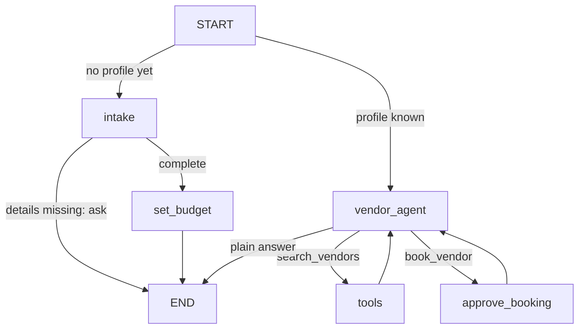

# Wedding planner (LangGraph + LangChain starter)

A small learning project. LangGraph handles the workflow (shared state, branching,
memory, pausing for approval). LangChain supplies the model, tools and structured output.
The vendor catalog is fake data.

## Run it

```bash
pip install -r requirements.txt
export ANTHROPIC_API_KEY=...          # any LangChain model works: set WEDDING_MODEL
python main.py
```

Try: *"Ana and Ben, Austin, June 12 2027, about 120 guests, $40k budget"*, then
*"find us a venue"*, then *"book the barn"*. The app asks you to approve before it books.

Tests use a scripted fake model, so they need no key: `python -m pytest -q`

## How it flows



| File | What it shows |
|------|---------------|
| `wedding_planner/state.py` | Shared state (`TypedDict` + `add_messages`) and a Pydantic `Profile` |
| `wedding_planner/nodes.py` | **intake**: `with_structured_output` pulls details from chat. **set_budget**: plain Python, no LLM. **vendor_agent**: `bind_tools`. **approve_booking**: `interrupt()` for human approval |
| `wedding_planner/tools.py` | `@tool` functions over a fake vendor list |
| `wedding_planner/graph.py` | `StateGraph`, conditional edges, `ToolNode`, checkpointer |
| `main.py` | Terminal chat; resumes after approval with `Command(resume=True/False)` |

## Ideas for next steps

1. **Keep state between runs**: swap `InMemorySaver` for `SqliteSaver` (`langgraph-checkpoint-sqlite`).
2. **Guest agent**: a `guests` list in state, RSVP tools, a seating chart via structured output.
3. **Timeline agent**: count back from the date (venue 12 months out, invites 8 weeks out).
4. **Supervisor**: an LLM router that picks the vendor, guest or timeline agent.
5. **RAG**: load vendor contracts into a vector store and answer "what's the cancellation policy?"
6. **Real data**: replace `VENDORS` with a places or search API.
