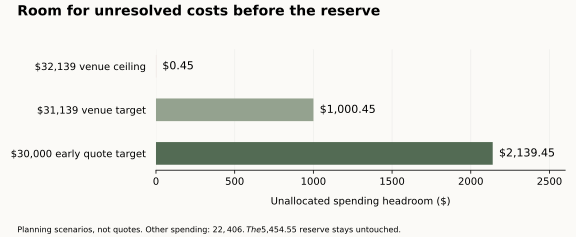

# Wedding budget review — Sean & Leila

**The budget can guide shopping, but it is not yet a fully priced wedding.** Its arithmetic works only if the already-reduced allowances can be achieved. The best improvement is to buy complete service and a comfortable room layout, then choose a simpler, cohesive design within the remaining allowances.

Reviewed November 8, 2026. Six independent reviews covered arithmetic, venue/catering value, vendors, décor/attire, taxes/fees and logistics. The baseline remains **185 guests, $60,000 total, $54,545.45 maximum spending and $5,454.55 kept untouched**. The preferred November 2027 dates and all required venue features remain intact. No new savings are secured by this review.

Open the [82-line quote tracker](budget_quote_tracker.csv), [existing venue ranking](ranked_budget_options.md) or [Old Hickory review](old_hickory_deep_review.md). The original workbook and model allocations have not been changed. Proposed reallocations below are choices to price, not accepted purchases.

## What the current budget actually assumes

The original priced must-haves total **$76,658.13**, before seven unpriced mandatory venue items. That is not a complete bid and should not be mistaken for current committed spending. The model already reduces non-venue allocations from **$31,475 to $22,406** and replaces the original venue-driven estimates with a **$32,139 ceiling**.

Those **$9,069 of non-venue reductions are already used** to make the current plan fit. They include cheaper coordination, video, DJ, attire, rings, centerpieces and candles. Skipping favors, uplighting, a photo booth, transport or a rehearsal dinner creates no further saving: those optional items are already unfunded. Only the photographer's $750 is marked booked in the workbook; payment balance and contractual scope are not documented here.

| Existing allocation | Cap | Most important estimate gap |
|---|---:|---|
| All venue-driven costs | $32,139 | Complete 2027 quote, required rooms, full service and fees |
| Fixed venue/food costs | $2,635 | $700 insurance, $935 specialty linens/chargers, $400 vendor meals, $600 wedding-night room; all need complete scope |
| Planning/legal | $5,250 | $2,500 coordinator, $2,000 tips, $500 officiant, $50 license, $200 miscellaneous |
| Flowers/décor | $5,446 | Current plan assumes a free arch and percentage-based labor |
| Attire/beauty | $4,375 | Dress, rings, alterations, trial and tax need realistic shopping limits |
| Photo/video | $2,550 | Booked $750 photographer plus unquoted $1,800 video |
| Music/sound | $2,000 | $1,500 DJ plus $500 separate-room sound; coverage hours unknown |
| Stationery | $150 | Thank-you cards; other listed stationery is a gift |
| Guests/transport and pre/post events | $0 | No host-paid commitments are funded |
| **Total planned spending at every cap** | **$54,545** | **Only $0.45 below the spending limit** |

The $2,635 fixed line sits outside the $32,139 envelope; together they form the existing $34,774 venue/food category. The separate $5,454.55 reserve is never available to fill these gaps.

**Suggested internal shopping target: $30,000 or less for the complete venue-driven bill while the other estimates remain unquoted.** That leaves $2,139.45 inside the spending limit if the other caps hold. A $31,139 venue bill leaves $1,000.45; the hard $32,139 ceiling leaves $0.45. These are planning scenarios, not vendor offers or new mandatory caps. Do not disclose the internal targets to vendors.

## Ranked improvements

| Rank | Improvement | Benefit and budget implication |
|---|---|---|
| **1** | Compare a complete package with a complete hall-and-catering proposal | The largest opportunity. Every **$10 per guest in the final catering bill changes cost by $1,850**. A $10 menu change before 22% service and 9% tax changes it by $2,460.13. Match food, bar hours, staffing, rooms, rentals and cleanup before comparing. |
| **2** | Turn the décor cap into a labor-inclusive design | Concentrate flowers where they will be seen, use low arrangements and a consistent sage/stone/ivory palette, and price moving ceremony pieces. Keep a paid/included backdrop solution and setup/strike in the design. The current $0 arch and 12% labor formula are not secured prices. |
| **3** | Set all-in attire shopping limits before purchasing | The $4,375 cap already assumes $2,625 below the original estimate. Preserve alterations and a useful beauty trial by choosing dress, accessories and bands within explicit limits; an inexpensive dress that needs major alterations can defeat the saving. |
| **4** | Eliminate only documented duplication | Potential overlap: basic versus specialty linens; candle installation versus florist labor; coordinator versus venue management; DJ versus separate sound; hotel versus getting-ready access. Count each saving once, after the same required scope is covered. |
| **5** | Price the actual floor plan and work schedule | Nineteen tables assumes ten guests each. Twenty-four tables at eight each add **$810 before additional rental tax** under current formulas if the extra linens and décor are separately purchased. Confirm setup, room flip, service, strike and collection responsibilities. Coordination supervision does not supply a labor crew. |
| **6** | Replace fee percentages and starting prices with itemized quotes | Keep taxes, travel, assistants, minimums and overtime inside each cap. Record service charges, required gratuities and discretionary tips separately. Do not assume a service fee replaces tips or add the same gratuity twice. |
| **7** | Release upgrades only after required costs are funded | Keep confirmed savings unallocated until all major quotes and floor plans fit. Then prioritize reliable service, sound and the moments you want recorded before additional décor. Cross-category spending still needs a deliberate revision of the locked caps. |

An attractive package venue can offer better value than a cheaper hall when its furniture, rooms and staff fit the event. A complete $31,000 package may be preferable to an incomplete $29,000 hall plan. Continue comparing **Oak Room, Gathering Place, Heritage and Beth El** with **The Villa, Crowne Plaza and Old Hickory**; none has a complete qualifying 2027 quote. See the [venue strategy review](research/budget_venue_strategy_review.md) for comparable model scenarios and their assumptions.

## Where estimates most need improvement

**Flowers and décor:** the $5,446 cap is $2,744 below the original estimate. Its current $546 delivery/setup allowance is calculated automatically, not quoted. A cheaper flower order does not necessarily need fewer staff hours or avoid late-night collection. Get a design that states the number of tables, candle vessels, ceremony piece, rental ownership, moving labor and end-of-night pickup. A retail arrangement price is not a full-service wedding installation.

**Attire and beauty:** the current model cuts the beauty trial from $250 to $125 while assuming a $1,200 dress, $300 suit and $1,200 bands. These are shopping targets. The [design and attire review](research/budget_design_attire_review.md) gives a proposed allocation within the same caps that explicitly funds an arch, tax, stronger labor allowances, alterations and a $400 trial. It also links official local pricing and describes the resulting design choices. None of those proposed amounts is a supplier quote.

**Video:** retain the $1,800 allowance, but treat its scope as unresolved. Published leads range from short coverage to eight hours, and the lowest advertised price may exclude the full ceremony edit or necessary travel. Complete's dated 2026 $1,795 example becomes $1,866.80 under the existing 4% planning rule. Ask for a video-only 2027 quote and prioritize usable ceremony/speech audio and agreed milestones. [Video comparisons](research/budget_vendor_review.md#2-photo-and-video-preserve-the-moments-before-buying-extras).

**Coordination and DJ:** White Dress Black Tie, Mayapple and MICKNICS remain sensible independent coordination inquiries. Include the assistant, rehearsal, hours and travel. Black Tie's coordination is tied to its DJs according to its official services page, so assess an itemized combined offer. Its undated lowest DJ tier yields $1,475 for six hours before unknown additions; retaining $500 sound makes $1,975 against the $2,000 cap. There is little room for extra hours. [Vendor review and official links](research/budget_vendor_review.md).

**Taxes and small extras:** the model does not separately add tax to several non-venue purchases or the cake lines. That is an unresolved inclusion question, not proof that every allowance must rise. If $9,335 of selected goods were pretax, a 6% sensitivity adds $560.10; cake-related taxes could add further cost. Require tax-inclusive totals within the current caps. Tax on service charges also varies by jurisdiction and itemization, so apply the actual invoice treatment rather than one blanket percentage. [Fee review](research/budget_fee_risk_review.md).

**Insurance and payment timing:** the $700 comprises $300 liability plus $400 cancellation insurance. Keep both purposes covered. Deposits credited toward contracts are payments, not extra expenses; refundable damage deposits still need available cash outside the protected reserve. Track payment dates and nonrefundable exposure separately from the final wedding cost.

## Spend where it improves the day

My provisional priority is a comfortable, well-run celebration: sufficient hot food and efficient service; hosted beer/wine for the agreed hours; clear ceremony and speech sound; a good DJ; and staff who let you and your guests enjoy the event. Keep the required heated ceremony plan, separate cocktail space and 185 seats with the dance floor intact.

For appearance, select a room you like with its standard furniture and lighting, then concentrate a coordinated floral design at the ceremony and guest tables. Reusing arrangements can help only when the moving work is assigned and priced. Standard included linens may be attractive in your palette, but the $935 line covers both specialty linens **and chargers**: included basic linens alone do not release the entire amount. Changes to the required specialty design remain your choice.

Old Hickory has potentially valuable included items, but its coordinator is not yet proven to replace your independent coordinator, and onsite parking is not yet verified free. Keep those allowances until confirmed. Its earlier $119.50 package figure was a ceiling, not a quote. [Full Old Hickory assessment](old_hickory_deep_review.md).

## Use the tracker before committing

The [CSV tracker](budget_quote_tracker.csv) carries all 82 original items, their status and current fixed targets. Blank venue targets belong to the **single** venue envelope; do not add old estimates to a package that already includes them. Blank quote/payment cells mean unknown. Optional rows are already excluded.

For every shortlisted option, collect the complete 2027 amount, covered quantities/hours, included tax/service, required exclusions, payment schedule and the responsible supplier. Link bundled items to the row that pays for them. Forecast the wedding as **full contracted totals plus complete remaining allowances**; use payments only to calculate outstanding cash. Confirm the 185-person count and separately reconcile actual vendor meals.

Before releasing any headroom, secure the approved floor plan, full venue/catering proposal, décor/labor quote, attire/beauty totals, coordination, music and video coverage. A hypothetical 10% overrun on the $21,656 of unbooked non-venue allocations would add $2,165.60. With a $31,139 venue bill, that would exceed the spending limit by $1,165.15. This is a stress check, not a forecast; it shows why the reserve cannot be treated as the solution to incomplete estimates.

## Review coverage and remaining limitations

**Budget readiness: needs quote-backed revisions. Review completeness: complete for the supplied workbook and current planning assumptions; actual contracts and 2027 availability remain unverified.** All 82 workbook rows and the cap arithmetic were reconciled. The chart compares planning targets only. This review added the tracker and proposed allocations, corrected an insurance interpretation and a vendor restriction in earlier notes, and retained the source budget/model.

The model's legacy “FITS” output is not a booking decision: it does not enforce all vendor/candle/end-time requirements or the current $1,000 headroom rule, and it still displays reserve-spending alternatives that are disallowed here. A latent cake-included/cutting-extra calculation issue was also identified; no saved current spec was found with that combination. These are documented for correction, not silently treated as validated prices.

Supporting reviews: [arithmetic and every source row](research/budget_math_audit.md), [venue strategy](research/budget_venue_strategy_review.md), [vendors](research/budget_vendor_review.md), [design/attire](research/budget_design_attire_review.md), [fees/taxes](research/budget_fee_risk_review.md), [logistics](research/budget_logistics_review.md). Workbook amounts come only from [the supplied extract](../budget/venue_neutral_items.md); category policy comes from [the project instructions](../CODEX_PROMPT.md). Official supplier links and price years are retained in the relevant review. Reproduce the central arithmetic with `python3 wedding/output/review_budget.py`. No vendor was contacted.
